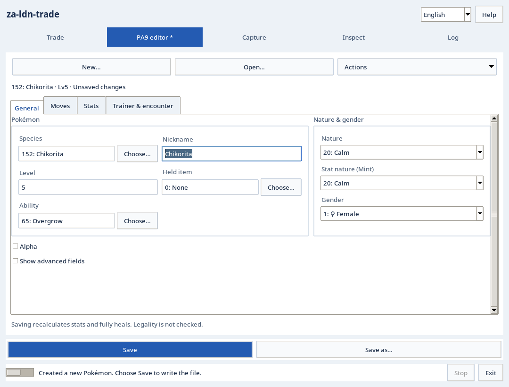

# za-ldn-trade

[日本語](#日本語) | [English](#english) · [Download / ダウンロード](https://github.com/hrvtuirvw/za-ldn-trade/releases/tag/v0.9.2)

## 日本語

[English](#english) · [使い方](docs/USER_GUIDE.md) · [無線対応表](docs/WIRELESS_COMPATIBILITY.md) · [困ったとき](docs/TROUBLESHOOTING.md)

『Pokémon LEGENDS Z-A』で、好きなポケモンを作って実機に送るためのツールです。PCで種族やフォルムなどを指定してPA9ファイルを作成し、そのポケモンをローカル交換で送れます。既存のPA9を編集したり、通信データを解析したりすることもできます。

対象は『Pokémon LEGENDS Z-A』2.0.2です。開発時の環境では、作成したポケモンを実機に送る動作を確認しています。ただし、この配布版での実機交換や、ほかのPC・無線アダプターでの動作は未確認です。

<a id="できること"></a>

### 主な機能

- **好きなポケモンを作って送る**：種族やフォルムを選んでPA9を作成し、ローカル交換で実機に送れます。御三家ギフト6種のプリセットと、490通りの種族・フォルムの組合せに対応しています。
- **PA9を編集する**：既存ファイルの読み込み・編集・保存に対応。技や持ち物、特性などの検索、能力値の計算、内部値の編集もできます。
- **通信データを調べる**：暗号化・復号済みPA9と、保存済みの通信キャプチャを解析できます。種族・技・持ち物・特性は日本語名、英語名、番号で検索できます。

PA9の作成・編集だけなら、ゲーム本体、鍵、既存のセーブデータ、Wi-Fiアダプターは不要です。実機に送るときは、以下の無線環境が必要になります。

<a id="ローカル交換を試す"></a>

### 作ったポケモンを実機に送る

使い方は、**PA9を作る → 無線環境を準備する → Relay経由でローカル交換する**、という流れです。PA9の作り方は後述します。

交換には**Linux、Python 3.12以上、対応ドライバ、専用のWi-Fiアダプター**が必要です。無線通信を担当するRelayはLinuxで動かします。GUIはWindows/Linuxのどちらからでも接続でき、管理者権限が必要なのは無線処理側だけです。

通常のWindowsのWi-FiやWSLの仮想Ethernetでは、必要なLDN無線通信を行えません。

1. **アダプターを確認する。** 購入前に[無線対応表](docs/WIRELESS_COMPATIBILITY.md)を確認してください。インターネット接続やSSHに使っているアダプターとは分けてください。
2. **Linux側の無線環境を準備する。** [無線の準備](docs/USER_GUIDE.md#無線の準備)に沿って設定し、`doctor --radio`で必要条件を確認します。この診断は読み取り専用ですが、通過しても接続や交換が成功するとは限りません。
3. **RelayとGUIを接続して交換する。** 作成したPA9を使ってローカル交換を行います。Relayはインターネットに公開せず、同じPCから接続するかSSH転送を使ってください。交換時は相手の個体を確認してから承認します。自動承認は初期設定では無効です。

開発時のアダプターは**AWUS036ACH（RTL8812AU）**、ドライバは`rtw88_8812au`です。**AWUS036ACHMは別製品**なので注意してください。[BSS補助](docs/BSS_HELPER.md)は必要な場合だけ使う追加機能で、初期設定では無効です。ドライバの代替や認証の回避には使えません。

交換できたか判断できない場合は、すぐに再試行せず、実機の状態と受け取った個体の保存ファイルを確認してください。交換・保存中は電源を切らず、アプリが終了処理を終えるまで待ってください。

<a id="まず起動する"></a>

### インストールと起動

ソースZIPを展開し、そのフォルダーで作業します。ZIP・wheelともにPythonが必要です。Python同梱の実行ファイルではありません。

#### Linux

GUIの起動にはPython 3.10以上、venv、Tkが必要です。Debian/Ubuntuでは`python3-venv`と`python3-tk`、Arch系では`python`と`tk`を用意してください。交換機能を使う場合は、前述のとおり無線処理側にPython 3.12以上が必要です。

一般ユーザーで実行します。

```sh
sh scripts/setup_za.sh
sh scripts/start_za_gui.sh
```

初回に必要なパッケージをダウンロードして、フォルダー内の`.venv-za`にインストールします。このスクリプトはドライバや無線設定を変更しません。

#### Windows

Python 3.10以上をTcl/TkとPython launcher付きでインストールし、展開したフォルダーでPowerShellを開きます。

```powershell
py -3 -m venv .venv-za
.\.venv-za\Scripts\python.exe -m pip install -r requirements-za.txt
.\Start-za-ldn-trade.cmd
```

次回からは`Start-za-ldn-trade.cmd`をダブルクリックして起動できます。PA9の編集に管理者権限は必要ありません。Windowsから交換機能を使う場合も、無線通信を担当するLinuxのRelayは別途必要です。

wheelでの導入は[使い方ガイド](docs/USER_GUIDE.md#wheel)を参照してください。ダウンロード済みのwheelを使う手順で、PyPIからのインストールではありません。

<a id="最初のpa9を保存する"></a>

### 送るポケモンを作る


*Linuxでの表示例。画面内の個体はデモ用の架空データです。*

交換で送りたいポケモンをGUIで作成します。すでにPA9ファイルがある場合は、開いて編集することもできます。

1. 「PA9編集」で「新規作成」を選ぶ
2. 作成方法、種族、トレーナー名、個体の言語を指定する。TID16/SID16は手入力するか「新しいIDを生成」を使う
3. 「作成して編集」で内容を確認する
4. 「保存」で保存先を指定する

「保存」には入力チェックと適用も含まれるため、先に「適用」を押す必要はありません。「適用」だけではファイルには書き込まれません。別のファイルとして残す場合は「名前を付けて保存」を使ってください。

ファイルの構造と値の範囲は「操作 → 構造チェック」で確認できます。ウィンドウが狭い場合は「ファイル → 操作」から開けます。ページ切替と保存ボタンはスクロールしても表示されたままです。

能力値を再計算するとHPと状態異常も回復します。PA9の作成・保存だけで無線通信が始まることはありません。表示言語は編集中でも切り替えられ、入力内容や個体に記録された言語は変わりません。詳しくは[PA9ガイド](docs/PA9_CREATION.md)を参照してください。

ショートカット：`Ctrl+N` 新規作成 / `Ctrl+O` 開く / `Ctrl+S` 保存 / `Ctrl+Shift+S` 名前を付けて保存 / `F1` ヘルプ / `Ctrl+L` 言語切替 / `Ctrl+Q` 終了 / `Alt+1〜5` 画面切替

<a id="制限と動作確認"></a>

### 動作確認と制限

現在はプレリリースです。実機とのローカル交換・保存・無線状態の復旧は、開発時のLinux環境で確認しています。この配布版での実機交換・保存・復旧、ほかのPCや無線アダプター・ドライバでの動作、Windows/WSLでの動作は未確認です。確認した構成と範囲は[検証情報](docs/TESTING.md)にまとめています。

PA9の構造チェックは、ゲーム内で正規に入手できる個体かどうかを判定するものではありません。作成したPA9がゲームで読み込めることや、実際に交換できることも保証しません。能力値を再計算しても出会った場所や技の不整合は直りません。

<a id="目的別ガイド"></a>

### ドキュメント

| 内容 | 参照先 |
|---|---|
| 無線アダプターとドライバの条件 | [無線対応表](docs/WIRELESS_COMPATIBILITY.md) |
| セットアップ・基本操作・無線の準備 | [使い方](docs/USER_GUIDE.md) |
| コマンドと接続例 | [CLIリファレンス](README_ZA.md) |
| 検証済み・未確認の項目 | [検証情報](docs/TESTING.md) |
| PA9の作成・形式・能力値計算 | [PA9ガイド](docs/PA9_CREATION.md) |
| 起動・ファイル・接続の問題 | [困ったとき](docs/TROUBLESHOOTING.md) |

開発関連：[貢献ガイド](CONTRIBUTING.md) · [翻訳](docs/LOCALIZATION.md) · [変更履歴](CHANGELOG.md) · [リリースノート](RELEASE_NOTES.md) · [公開手順](docs/RELEASING.md) · [セキュリティ](SECURITY.md)

<a id="開発ライセンス"></a>

### ライセンス・注意事項

[frlg-ldn-trade](https://github.com/tornadus/frlg-ldn-trade)に着想を得て、同プロジェクトの通信実装をベースに開発しています。PythonアプリはAGPL-3.0-only、別途ビルドするカーネル補助はGPL-2.0-onlyです。詳しくは[LICENSE](LICENSE)と[第三者ライセンス・PKHeX由来データの出典](THIRD_PARTY_NOTICES.md)を参照してください。

Nintendo、Game Freak、The Pokémon Company、PKHeXの公式ツールではありません。ゲームコード、ROM、秘密鍵、個人のセーブデータは同梱していません。不具合報告にも、これらや個人のPA9、未加工の通信ログを添付しないでください。

## English

[日本語](#日本語) · [User guide](docs/USER_GUIDE_EN.md) · [Wireless compatibility](docs/WIRELESS_COMPATIBILITY_EN.md) · [Troubleshooting](docs/TROUBLESHOOTING.md)

Create Pokémon for Pokémon LEGENDS Z-A and send them to your console through local trading. Choose a species, form and other details on your PC, save a PA9 file, then trade that Pokémon to the game. You can also edit existing PA9 files and analyze communication data.

The target game version is Pokémon LEGENDS Z-A 2.0.2. Sending created Pokémon to a console has been tested in the developer's earlier setup. Real-console trading with this release, and operation on other PCs or Wi-Fi adapters, remain unverified.

<a id="features"></a>
<a id="inside-the-application"></a>

### Main features

- **Create and send Pokémon:** choose a species and form, create a PA9, then send it to your console through local trading. Six starter gift presets and 490 species/form combinations are available.
- **Edit PA9 files:** open, edit and save existing files. Look up moves, items and abilities, calculate stats, or edit raw fields.
- **Inspect communication data:** analyze encrypted or decrypted PA9 files and saved packet captures. Species, moves, items and abilities can be searched by Japanese name, English name or number.

Creating and editing PA9 files does not require a console, console keys, an existing save or a Wi-Fi adapter. Sending them to a console requires the wireless setup described below.

<a id="experimental-local-trading"></a>

### Send a Pokémon to your console

The process is **create a PA9 → prepare the wireless setup → trade through Relay**. PA9 creation is explained further down.

Trading requires **Linux, Python 3.12+, a compatible driver and a dedicated Wi-Fi adapter**. Relay handles wireless communication and runs on Linux. The GUI can connect from either Windows or Linux; only the wireless process needs elevated privileges.

Native Windows Wi-Fi and WSL's virtual Ethernet cannot provide the required LDN wireless communication.

1. **Check the adapter.** Read the [wireless compatibility guide](docs/WIRELESS_COMPATIBILITY_EN.md) before buying one. Use a separate adapter from the one carrying your Internet or SSH connection.
2. **Prepare wireless on Linux.** Follow [wireless setup](docs/USER_GUIDE_EN.md#wireless-setup), then run `doctor --radio` to check the prerequisites. This is a read-only check, and passing it does not guarantee a successful connection or trade.
3. **Connect the GUI to Relay and trade.** Use the PA9 you created for the local trade. Do not expose Relay to the Internet: connect locally or use an SSH tunnel. Check the other player's Pokémon before approving the trade. Automatic approval is off by default.

The development adapter is **AWUS036ACH (RTL8812AU)**, with the `rtw88_8812au` driver. **AWUS036ACHM is a different product.** The optional [BSS helper](docs/BSS_HELPER_EN.md) is off by default and should only be used when needed. It does not replace the driver or bypass authentication.

If you cannot tell whether a trade completed, do not immediately try again. First check the console and the file saved for the received Pokémon. Do not power off during trading or saving; wait for the application to finish cleanup.

<a id="quick-start"></a>

### Installation and startup

Extract the source ZIP and work from that folder. Both the ZIP and wheel require Python; neither is an executable with Python bundled in.

#### Linux

The GUI requires Python 3.10+, venv support and Tk. On Debian/Ubuntu, install `python3-venv` and `python3-tk`; on Arch-based distributions, use `python` and `tk`. For trading, the wireless process needs Python 3.12+ as described above.

Run as a normal user:

```sh
sh scripts/setup_za.sh
sh scripts/start_za_gui.sh
```

Setup downloads the required packages into `.venv-za` in the extracted folder. It does not change drivers or wireless settings.

#### Windows

Install Python 3.10+ with Tcl/Tk and the Python launcher, then open PowerShell in the extracted folder.

```powershell
py -3 -m venv .venv-za
.\.venv-za\Scripts\python.exe -m pip install -r requirements-za.txt
.\Start-za-ldn-trade.cmd
```

After setup, double-click `Start-za-ldn-trade.cmd`. PA9 editing does not require Administrator privileges. Trading from Windows still requires a separately prepared Linux Relay for wireless communication.

For wheel installation, see the [user guide](docs/USER_GUIDE_EN.md#wheel). These instructions use a downloaded wheel, not a package installed from PyPI.

<a id="make-your-first-file"></a>

### Create a Pokémon to send



*Linux screenshot. The Pokémon shown is fictional demonstration data.*

Use the GUI to create the Pokémon you want to send. If you already have a PA9 file, you can open and edit it instead.

1. Select **New…** in **PA9 editor**.
2. Choose the creation method, species, trainer name and Pokémon language. Enter TID16/SID16 yourself or select **Generate new IDs**.
3. Select **Create & edit** and review the record.
4. Select **Save** and choose a filename.

**Save** checks and applies your input, so you do not need to select **Apply** first. **Apply** alone does not write a file. Use **Save as…** to keep the result in a separate file.

Use **Actions → Validate** to check the file structure and value ranges. In compact windows, this is under **File → Actions**. Section navigation and Save stay visible while the form scrolls.

Recalculating stats also restores HP and clears status conditions. Creating or saving a PA9 does not start wireless communication. You can switch the interface language while editing without losing your input or changing the Pokémon's stored language. See the [PA9 guide](docs/PA9_CREATION_EN.md) for details.

Shortcuts: `Ctrl+N` New / `Ctrl+O` Open / `Ctrl+S` Save / `Ctrl+Shift+S` Save as / `F1` Help / `Ctrl+L` Language / `Ctrl+Q` Exit / `Alt+1–5` Switch tasks

<a id="limitations-and-testing"></a>

### Testing and limitations

This is a prerelease. Real-console trading, saving and restoration of the wireless interface were verified in an earlier Linux development setup. Those operations have not been verified with this release. Windows/WSL operation and compatibility with other PCs, Wi-Fi adapters or drivers are also unverified. The tested configurations and scope are recorded in the [testing notes](docs/TESTING.md).

PA9 validation does not determine whether a Pokémon can be obtained legitimately in-game. It also does not guarantee that a created PA9 will load or trade in-game. Recalculating stats does not fix invalid encounter data or moves.

<a id="guides"></a>
<a id="find-the-right-guide"></a>

### Documentation

| Topic | Reference |
|---|---|
| Wi-Fi adapter and driver requirements | [Wireless compatibility](docs/WIRELESS_COMPATIBILITY_EN.md) |
| Setup, everyday use and wireless preparation | [User guide](docs/USER_GUIDE_EN.md) |
| Commands and connection examples (Japanese) | [CLI reference](README_ZA.md) |
| Tested and unverified configurations | [Testing notes](docs/TESTING.md) |
| PA9 creation, formats and stat calculation | [PA9 guide](docs/PA9_CREATION_EN.md) |
| Startup, file or connection problems | [Troubleshooting](docs/TROUBLESHOOTING.md) |

Development: [Contributing](CONTRIBUTING.md) · [Localization](docs/LOCALIZATION.md) · [Changelog](CHANGELOG.md) · [Release notes](RELEASE_NOTES.md) · [Release procedure](docs/RELEASING.md) · [Security](SECURITY.md)

<a id="contributing-and-license"></a>
<a id="開発ライセンス--development-and-license"></a>

### License and notices

Inspired by [frlg-ldn-trade](https://github.com/tornadus/frlg-ldn-trade) and built on its communication implementation. The Python application is licensed under AGPL-3.0-only; the separately compiled kernel helper is GPL-2.0-only. See [LICENSE](LICENSE) and [third-party notices, including the sources of PKHeX-derived data](THIRD_PARTY_NOTICES.md).

This is not an official tool from Nintendo, Game Freak, The Pokémon Company or PKHeX. It does not include game code, ROMs, secret keys or personal save data. Do not attach these, personal PA9 files or unredacted packet captures to bug reports.
